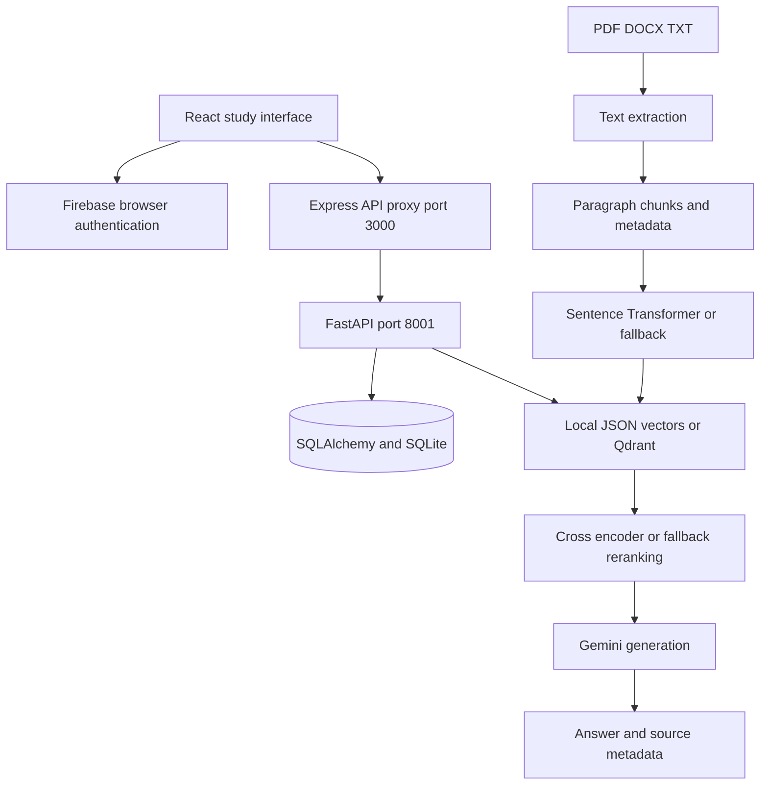

<a id="top"></a>

<div align="center">

# 🧠 EduMind AI — Study Assistant

**Document-grounded study chats with a React interface and a Python RAG backend.**


[Repository](https://github.com/ashishgiije/Ai-study-assistant) · [Overview](#overview) · [Architecture](#architecture) · [Setup](#setup) · [Validation](#testing-and-validation) · [Audit](AUDIT_REPORT.md)

</div>

## Overview

EduMind combines study chats, uploaded documents, and generated explanations. This checkout includes a React client, Express proxy, and Python retrieval pipeline. The server tracks Python readiness and supports a lightweight embedding mode for constrained hosts.

## Visual preview

**Screenshot placeholder:** No verified application screenshot is supplied here. Capture the study chat, indexed document list, and citation card using disposable notes. No image is fabricated.

## Key features

- Firebase-backed browser sign-in and profile UI.
- Study chat creation, renaming, deletion, and persisted message history.
- PDF, DOCX, and TXT extraction, document indexing, and deletion.
- Chat-scoped vector retrieval, optional document filtering, reranking, and source metadata.
- Gemini general-study responses without documents and context-grounded responses with documents.
- Suggested questions and UI source citation cards.

## Technology stack

| Technology | Role in this checkout |
|---|---|
| React 19 + TypeScript + Vite | Study interface |
| Express + tsx | UI server and API proxy |
| Python + FastAPI + SQLAlchemy | Chat/document API and relational persistence |
| PyMuPDF + python-docx | PDF and DOCX text extraction |
| Sentence Transformers + optional Qdrant | Embeddings, retrieval, and reranking |
| Google GenAI + Firebase | Answer generation and browser sign-in |

## Architecture



## Application workflow

Sign in in the browser → open a study chat → upload notes → extract and index document chunks → ask a question → retrieve chat-scoped context → rerank → generate an answer and source cards → persist the exchange. Browser sign-in is implemented, but the API does not securely verify that identity; see the audit.

## Setup

```bash
git clone https://github.com/ashishgiije/Ai-study-assistant.git
cd Ai-study-assistant
```

Use Node.js 22+, Bun, and Python 3.12 with a virtual environment. Both the Node and Python dependencies are required.

```bash
python3 -m venv .venv
. .venv/bin/activate
pip install -r requirements.txt
bun install --frozen-lockfile
cp .env.example .env
```

Set `GEMINI_API_KEY` privately and select a provider-supported `GEMINI_MODEL`. Configure Firebase authentication/project access using the supported browser configuration in `src/lib/firebase.ts`; the checked-in project identifiers do not grant administrative access. Use a private local `.env` and never commit real credentials.

```bash
# Keep the Python virtual environment active so the server can spawn python3
export DATABASE_URL="sqlite:////tmp/edumind-dev.sqlite3"
export UPLOAD_DIRECTORY="/tmp/edumind-dev-uploads"
npm run dev
```

Open `http://localhost:3000`. The Express server automatically spawns Uvicorn on port 8001; do not start a second copy on the same port. SQLite tables are initialized by the Python backend. Models load on demand and require network access/cache and sufficient memory. Leave `QDRANT_URL` empty for the built-in local JSON vector store; set `QDRANT_URL`, optional `QDRANT_API_KEY`, and `QDRANT_COLLECTION` for Qdrant. The local vector JSON path is relative to the process working directory.

```bash
npm run lint
npm run build
NODE_ENV=production npm start
```

`lint` runs TypeScript checking, not a formatter. Production requires both runtimes, private credentials, persistent storage, and the authorization fixes described in the audit.

For a lightweight development path, `USE_FALLBACK_EMBEDDINGS=true` selects the implemented deterministic hash embeddings. This reduces model requirements but does not validate learned semantic retrieval. The Python default database/upload paths are under `/tmp`; configure durable paths when persistence matters.

## Project structure

```text
server.ts                     # Express startup and Python subprocess
src/server/backend.ts         # API proxy
src/backend_python/main.py    # Chat, message, document endpoints
src/backend_python/db.py      # Chat/message/document models
src/backend_python/           # Extraction, chunking, vectors, RAG
src/components/study/         # Chat and document interface
src/context/AuthContext.tsx   # Browser auth state
src/lib/firebase.ts           # Firebase integration
```

## Retrieval and generation

| Stage | Source-backed behavior |
|---|---|
| Extraction | PDF pages, DOCX sections, and TXT input |
| Chunking | Paragraph packing; default target 900 characters with 150-character overlap |
| Embedding | Default `BAAI/bge-small-en-v1.5`; deterministic fallback when model loading is unavailable |
| Storage | Local JSON vector file; optional Qdrant collection with 384-dimensional vectors |
| Retrieval | Chat ID filter, optional document ID, default top 10 |
| Reranking | `cross-encoder/ms-marco-MiniLM-L-6-v2`, with keyword/vector fallback; default top 5 |
| Generation | Config default `gemini-2.5-flash`; verify provider availability |
| Sources | Document name/ID, page or section, excerpts, and relevance metadata |

The chunk size is a target, not a strict maximum: a single long paragraph can exceed it. Small result sets can bypass cross-encoder loading. This repository does not train these pretrained models or include a measured answer-quality benchmark. Source metadata provides traceability, not a guarantee that generated claims are correct.

## API

| Method | Path | Behavior |
|---|---|---|
| GET | `/health` | Express service and Python readiness flag |
| GET / POST | `/api/chats` | List/create study chats |
| GET / PATCH / DELETE | `/api/chats/{chat_id}` | Read/rename/delete a chat |
| GET / POST | `/api/chats/{chat_id}/messages` | History and question submission |
| GET / POST | `/api/chats/{chat_id}/documents` | List/upload documents |
| DELETE | `/api/chats/{chat_id}/documents/{document_id}` | Delete document and vectors |

The Python service also exposes `/health` and FastAPI’s generated `/docs` on port 8001. Current user handling accepts caller-controlled identity headers; message/document routes do not consistently enforce ownership. This is a security limitation, not a supported authentication scheme.

```bash
curl -X POST http://localhost:3000/api/chats \
  -H 'Content-Type: application/json' -H 'x-user-id: local-demo' \
  -d '{"title":"Study notes"}'
```

The create response is a chat object with a generated ID. Use that ID in subsequent paths:

```bash
curl -X POST "http://localhost:3000/api/chats/$CHAT_ID/documents" \
  -F 'files=@notes.txt'
curl -X POST "http://localhost:3000/api/chats/$CHAT_ID/messages" \
  -H 'Content-Type: application/json' \
  -d '{"question":"Summarize the uploaded notes"}'
```

A message result contains persisted answer/source information determined by the pipeline; no fabricated model response is shown. Use disposable local study material only until access controls are fixed.

## Testing and validation

Current source review and checks (4 November 2026):

`bun install --frozen-lockfile` and `npm run build` passed. `npm run lint` failed: server.ts passes a string | number port to a numeric app.listen overload. Health, chat create/read, TXT extraction/indexing, document list, and chat cleanup passed in fallback mode; Gemini and learned models unrun

Use the setup commands above and the documented workflow for a local smoke check. No passing automated application suite is claimed where none exists.

## Limitations and roadmap

- API identity headers and chat IDs do not provide secure per-user isolation.
- Model downloads, Gemini credentials, Firebase project access, and optional Qdrant connectivity are separate prerequisites.
- Hash/keyword fallbacks do not demonstrate learned model performance.
- The upload size setting is defined but not enforced by the upload handler.
- Suggested roadmap: verified Firebase tokens, consistent ownership checks, bounded safe uploads, reproducible retrieval tests, and durable deployment storage.

<details>
<summary>Troubleshooting and contributions</summary>

Check the runtime versions and working directory first. For dependency installation failures, preserve TLS and checksum verification and inspect the first error. For external services, verify your local configuration and account permissions without sharing secret values.

Before contributing, read [the audit](AUDIT_REPORT.md), reproduce the affected behavior, and keep documentation changes separate from application fixes. Add tests for changed behavior and describe remaining limitations accurately.

</details>

## Author

**Ashish Gije** · [GitHub](https://github.com/ashishgiije)

[Back to top](#top)
